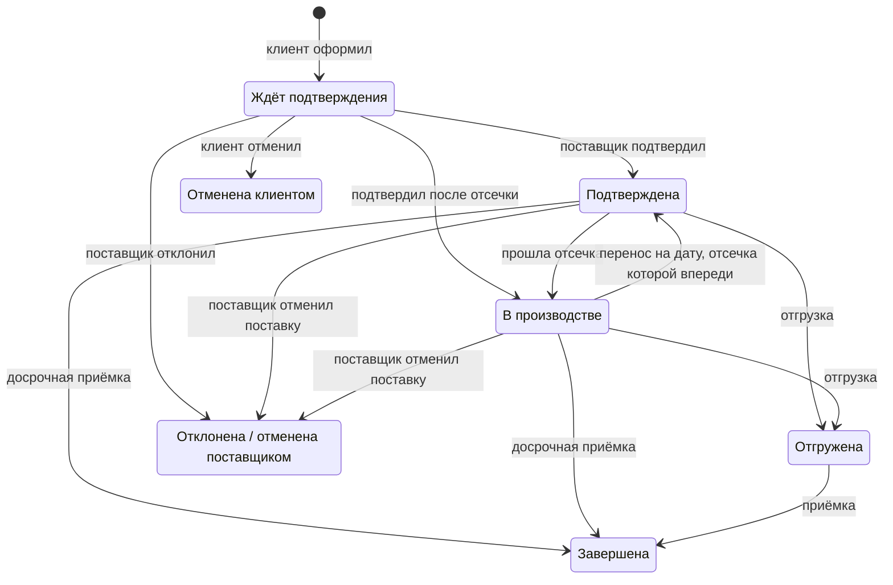

# Витрина поставщика в MAX: продукт и бизнес-логика

Документ описывает, что делает продукт и по каким правилам. Описание соответствует коду на 28 сентября 2026 года. Обоснования решений и исследование рынка — в [docs/product/concept.md](docs/product/concept.md), подключение настоящей 1С — в [docs/1c-connection.md](docs/1c-connection.md).

## 1. Что это за продукт

Мини-приложение и бот в мессенджере MAX. Через них небольшие магазины, кафе и киоски заказывают товар у своих постоянных поставщиков: оптовой базы, пекарни, производства. Заявка магазина сразу становится документом «Заказ клиента» в 1С поставщика.

**Какую проблему решает.** Сейчас заявки приходят поставщику голосовыми, фотографиями тетрадных листов и звонками. Менеджер уточняет наличие в переписке, а вечером перебивает всё в 1С руками. Магазин узнаёт, что товара нет, только в момент доставки.

**Что меняется:**
- Магазин сам собирает заявку по витрине, где видны актуальное наличие и цены. Заказать можно в любое время, в том числе повторить прошлую заявку или собрать по шаблону.
- Поставщик получает готовый документ, а не голосовое. Подтверждает его или правит в пару касаний, и заказ в 1С правится сам.
- Товар резервируется с момента заявки: два магазина не закажут один и тот же последний ящик, а заказ сразу появляется в 1С.
- После отсечки у пекарни есть сводка «сколько чего печь», у склада — листы сборки.
- Расхождения фиксируются при приёмке, а не на инвентаризации.
- Владелец видит оборот, точность отгрузки и клиентов, которые перестали заказывать.

**Почему MAX.** Обе стороны уже в мессенджере, и ставить ничего не нужно. Вход — по ссылке-приглашению, без регистрации и паролей: личность подтверждает сам MAX. Бот доставляет события второй стороне.

**Чего в продукте нет сознательно:**
- приёма оплаты и учёта долгов — сумма заявки считается и видна обеим сторонам, но деньги идут мимо продукта;
- складского учёта и себестоимости — это работа 1С;
- ЭДО и юридически значимых накладных;
- логистики;
- общего маркетплейса по всем поставщикам.

## 2. Роли и права

Роль — это пара «пользователь MAX ↔ предприятие или точка». У одного аккаунта может быть несколько ролей: например, владелец пекарни одновременно закупается у кондитерской базы как клиент. Роль переключается в «Аккаунте».

Сервер узнаёт человека только по подписанным данным запуска MAX. Роль выбирается из тех, что у человека действительно есть.

| Роль | Кто это | Как появляется |
|---|---|---|
| Владелец (`owner`) | собственник поставщика | сам, при регистрации «Поставщик» |
| Менеджер (`manager`) | сотрудник поставщика | только по приглашению владельца |
| Клиент (`client`) | владелец точки: магазина, кафе, киоска | сам, при регистрации «Клиент», или приняв приглашение поставщика |
| Работник магазина (`worker`) | продавец, товаровед точки | только по приглашению владельца точки |

| Действие | Владелец | Менеджер | Клиент | Работник |
|---|:-:|:-:|:-:|:-:|
| Подтвердить, отклонить, отгрузить заявку, перенести доставку, отменить подтверждённую поставку | ✓ | ✓ | | |
| Сводка на дату и листы сборки | ✓ | ✓ | | |
| Смотреть витрины и позиции предприятия | ✓ | ✓ | | |
| Заводить и настраивать витрины, позиции, цены, остатки, акции, фото; загружать прайс; настраивать обмен с 1С | ✓ | | | |
| Клиенты, подключения, сотрудники, приглашения, аудитория бота | ✓ | | | |
| Сводка предприятия, журнал обмена с 1С, выгрузка истории заявок | ✓ | | | |
| Оформить заявку, отменить её до подтверждения, принять товар | | | ✓ | ✓ |
| Шаблоны заявок, «Связаться», просьба о подключении с полки, выгрузка своих заявок | | | ✓ | ✓ |
| Пригласить и убрать работников, изменить название и адрес точки | | | ✓ | |
| «Написать» через бота | ✓ | ✓ | ✓ | ✓ |

**Первый вход.** Новый человек выбирает «Клиент» или «Поставщик»:
- клиент называет точку и может указать адрес;
- поставщик называет предприятие (это обязательно) и может выбрать город из справочника;
- на втором шаге оба могут указать телефон и отметить «Мне можно писать в MAX».

Менеджер и работник не могут назначить себя сами — только по ссылке-приглашению. Роль при регистрации выбирается один раз, остальные роли человек получает через приглашения.

**«Начать заново»** удаляет:
- свою точку вместе с её заявками;
- своё предприятие, если человек в нём единственный владелец (демо-предприятия не удаляются);
- членство в командах поставщиков и магазинов;
- неотвеченные приглашения;
- избранное.

Отключённые виды уведомлений сохраняются. Заявки, которые оформил работник, остаются у магазина.

## 3. Основные сущности

- **Предприятие** — поставщик. Хранит название, город (один, из справочника), общий контакт для «Связаться» — телефон и возможность написать владельцу в MAX — и признак демо.
- **Сотрудник** — владелец или менеджер предприятия, с графиком работы (дни и часы).
- **Витрина** — то, что видит клиент. У неё есть режим, источник данных, график доставки, отсечка, минимальная сумма, видимость на полке, показ цен, оформление и подключение к 1С. У одного предприятия может быть несколько витрин.
- **Позиция** — товар витрины: название, единица, кратность упаковки, цена, остаток, дневной лимит, фото, описание, признак «скрыта» и связь с номенклатурой 1С.
- **Клиент (точка)** — магазин или кафе с названием и адресом. Владелец точки — один пользователь MAX.
- **Работник магазина** — пользователь MAX в команде точки, с графиком.
- **Подключение** — связь клиента с витриной. Статусы: «запрос», «активно», «отключено».
- **Заявка** — витрина, клиент, автор (владелец точки или работник), дата доставки, статус, номер, ведущий менеджер, комментарии обеих сторон и номер документа в 1С.
- **Строка заявки** хранит три количества — заказано, подтверждено, принято — и цену, зафиксированную при оформлении.
- **Закреплённый менеджер** — один сотрудник поставщика на каждого клиента.
- **Приглашение** — код для клиента, менеджера или работника. Бывает общим (ссылка, которую можно переслать) и личным (принять может только адресат).
- **Акция** — скидка витрины одного из четырёх типов (раздел 6).
- **Шаблон заявки** — именованный набор количеств клиента для одной витрины.
- **Уведомление** — запись в ленте приложения: текст, вид, к какой заявке или витрине относится, дошло ли сообщение в MAX.
- **Событие обмена** — запись журнала обмена с 1С: что ушло или пришло, статус («выгружено», «в очереди», «ошибка») и номер документа.
- Кроме того: **история цен**, **избранное**, **отключённые виды уведомлений** и **сопоставление магазина с контрагентом 1С**.

## 4. Основной сценарий

1. Поставщик регистрируется и заводит витрину: вручную, загрузкой прайса или из своей 1С. Настраивает режим, дни доставки и отсечку.
2. Поставщик зовёт клиентов одним из трёх способов:
   - присылает ссылку-приглашение;
   - отправляет личное приглашение человеку из аудитории бота;
   - открывает витрину на полке города, где клиенты сами просят подключения.
3. Клиент открывает витрину, собирает корзину, выбирает дату доставки и оформляет заявку. Товар резервируется, в 1С появляется «Заказ клиента», поставщику приходит уведомление.
4. Менеджер подтверждает заявку как есть или правит количества, указывая причину. Заказ в 1С переходит «К выполнению» и проводится. Клиенту приходит уведомление, и первыми в нём стоят изменения.
5. У витрины под заказ после отсечки заявки переходят в статус «В производстве». Сводка на дату показывает, сколько каждой позиции нужно, и листы сборки по заявкам.
6. Поставщик отмечает отгрузку. Клиент принимает товар — полностью или с расхождениями. Расхождения уходят поставщику и комментарием в заказ 1С.
7. Владелец видит оборот, точность отгрузки и клиентов, которые давно не заказывали.

## 5. Витрина

### 5.1. Режим и источник данных

| | Со склада (`stock`) | Под заказ (`preorder`) |
|---|---|---|
| Для кого | оптовая база, у которой есть остаток | пекарня или цех, которые готовят по заявкам |
| Что видит клиент | доступное количество: остаток минус резерв | сколько ещё можно заказать на дату: дневной лимит минус уже заказанное |
| Отсечка | нет: заявки на дату принимаются до конца предыдущего дня | обязательна: заявки на дату принимаются до времени отсечки накануне |
| После отсечки | — | подтверждённые заявки на эту дату переходят в статус «В производстве» |

Источник данных — «вручную» или «1С». Витрина из 1С получает позиции, цены и остатки из учётной системы (раздел 9). Ручная витрина ведётся в приложении и загрузкой прайса.

### 5.2. Дни доставки и даты

- Дни доставки — дни недели. Если они не заданы, поставщик возит каждый день.
- Заявку можно оформить только на день из графика, начиная с завтрашнего и не дальше чем на 60 дней вперёд, и только пока приём заявок на эту дату не закрыт (см. 5.1).
- Клиент видит 8 ближайших доступных дат. У витрины под заказ он ещё видит, сколько минут осталось до отсечки ближайшей даты.
- Отсечка и графики считаются в местном времени поставщика. Часовой пояс один на весь стенд: `APP_TIMEZONE`, по умолчанию Москва.

### 5.3. Прочие настройки витрины

- **Минимальная сумма заявки.** Заявку меньше этой суммы не оформить. Сравнивается сумма уже со скидками.
- **Видимость.** Открытая витрина видна на полке, закрытая доступна только по приглашению.
- **Показ цен на полке** — отдельный флажок, по умолчанию выключен: оптовик не обязан показывать прайс конкурентам.
- **Напоминание об отсечке** — только у витрин под заказ. Настройка — за сколько минут до отсечки напомнить клиентам, которые ещё не заказали: от 0 до 1440, где 0 — не напоминать; по умолчанию 60.
- **Оформление:** логотип, фото витрины, цвет карточки и строка «о себе» до 160 знаков. Картинки — JPEG, PNG, WebP или HEIC до 8 МБ.
- Витрину можно удалить, только пока по ней не было заявок. После этого её можно лишь убрать с полки.

### 5.4. Позиции

- Название позиции не повторяется внутри витрины, регистр не учитывается. Цена больше нуля, кратность упаковки — не меньше 0,1.
- Количества везде задаются с точностью до 0,1: сыр и колбаса идут по 0,4–0,5 кг. Кратность проверяется в десятых долях без погрешностей дробных чисел.
- У складской ручной витрины поставщик сам ведёт остаток. У витрины под заказ вместо остатка — дневной лимит; если он не задан, ограничения нет.
- Каждое изменение цены попадает в историю цен: и ручная правка, и загрузка прайса, и сверка с 1С.
- Позицию, которую уже заказывали, удалить нельзя — только скрыть. Скрытую позицию клиент не видит и не может заказать, в прошлых заявках она остаётся.
- У витрины из 1С название и единицу задаёт 1С, в приложении их не поменять. Цену и остаток при ближайшей сверке перезапишут значения из 1С. Кратность, описание и фото задаёт поставщик.

### 5.5. Загрузка прайса

Загрузка нужна прежде всего витринам без 1С: у витрины из 1С цены и остатки перезапишет ближайшая сверка.

- Формат — CSV или Excel, до 4 МБ и 5000 строк.
- Колонки ищутся по названию в любом порядке: артикул, наименование, единица, кратность, цена, остаток. Принимаются и распространённые синонимы.
- Сначала — предпросмотр: что будет создано, что изменится и какие строки не удалось разобрать. Изменения применяются только отдельным действием.
- Позиция ищется по артикулу, затем по названию. Найденной обновляются цена, остаток, кратность и единица. Если позиция не найдена, она заводится.
- Текущий прайс выгружается в том же формате, поэтому выгрузка служит и шаблоном для загрузки.

## 6. Каталог, корзина и акции

**Что видит клиент:**
- Только витрины, к которым он подключён со статусом «активно», и только позиции, которые не скрыты.
- Неподключённый поставщик на полке показан без ассортимента, с кнопкой «Запросить подключение».
- У складской витрины — «доступно» и пометку «заканчивается», если осталось не больше трёх упаковок. У витрины из 1С — ещё и время, на которое актуальны данные.
- У витрины под заказ — сколько ещё можно заказать на ближайшую дату.

**Корзина** хранится на устройстве, своя у каждой витрины. На сервер она попадает только при оформлении: черновиков заявок на сервере нет. Если остаток изменился (например, кто-то забрал последнее), открытая корзина уменьшается до доступного количества и сообщает об этом.

**«Повторить прошлый заказ»** берёт последнюю заявку, которая не была отклонена или отменена, в подтверждённых количествах. Что не помещается в остаток, урезается; про позиции, которых в витрине уже нет, приложение сообщает.

**Шаблоны** — до 10 на витрину. Шаблон собирается из текущей корзины или из готовой заявки (тогда в подтверждённых количествах). Если сохранить шаблон под существующим названием, старый перезаписывается.

**Подсказка «пора заказать».** Если у клиента в витрине не меньше трёх заявок, считается его обычный интервал между заявками — медиана интервалов. Когда с последней заявки прошло не меньше этого интервала, на карточке витрины появляется подсказка.

**Точность отгрузки** витрины видна клиенту и на полке, когда за ней стоят хотя бы три принятые заявки.

**Акции** настраивает владелец. Скидка — от 0,1 до 99,9 %, у акции может быть срок действия. Типы:

| Тип | Как работает | Как видит клиент |
|---|---|---|
| На позицию | скидка на одну позицию | цена в каталоге уже со скидкой, старая цена рядом |
| На всю витрину | скидка на все позиции | так же |
| От суммы заявки | скидка на всю заявку, если её сумма не меньше порога | условие: «−10 % при заказе от 5 000 ₽» |
| От количества позиции | скидка на позицию, если её заказали не меньше порога | условие |

- Если к позиции применимы и своя акция, и акция на всю витрину, берётся большая скидка.
- Скидки «от суммы» и «от количества» применяются поверх цены, уже сниженной первыми двумя типами. Если к одной позиции подходят обе, берётся большая из них.
- Публичные акции видны всем на главной. Непубличные работают только для подключённых клиентов.
- Цена со скидкой фиксируется в заявке: клиент платит то, что видел.

## 7. Заявка

### 7.1. Статусы

| Статус | В интерфейсе | Когда | Что происходит |
|---|---|---|---|
| — | корзина | клиент собирает заявку | хранится только на устройстве, ничего не резервирует |
| `sent` | «Ждёт подтверждения» | клиент оформил заявку | товар резервируется; у витрины из 1С создаётся заказ; поставщику уходит уведомление |
| `confirmed` | «Подтверждена» | поставщик подтвердил | количества согласованы; у витрины из 1С заказ проведён, у ручной складской витрины товар списан с остатка |
| `assembling` | «В производстве» | подтвердили после отсечки или отсечка наступила позже | бывает только у витрин под заказ; заявка попадает в сводку производства |
| `shipped` | «Отгружена» | поставщик отметил отгрузку | клиенту приходит «примите товар» |
| `accepted` | «Завершена» | клиент принял товар | фиксируются принятые количества и расхождения |
| `rejected` | «Отклонена» или «Отменена поставщиком» | поставщик отказал до подтверждения или отменил подтверждённую поставку | резерв снимается, списанный товар возвращается на остаток, заказ в 1С снимается |
| `cancelled` | «Отменена» | клиент отменил до подтверждения | то же, что при отказе |

Статусы `draft` и `closed` есть в модели данных, но сервер их не ставит. Черновик живёт на устройстве, а автоматического закрытия после приёмки нет. `closed` встречается только в истории демо-данных и везде считается завершённой заявкой.

В разделе «в работе» — заявки, которые ждут подтверждения, подтверждены, в производстве или отгружены. В «истории» — завершённые, отклонённые и отменённые; на экране показываются последние 200.

### 7.2. Оформление

Сервер проверяет всё до сохранения и при отказе объясняет причину:

1. Точка подключена к витрине со статусом «активно».
2. В заявке есть позиции, и ни одна не повторяется.
3. Дата доставки допустима (см. 5.2). Если дату не указали, берётся ближайшая.
4. Позиция не скрыта, количество задано с шагом 0,1 и кратно упаковке.
5. Со склада можно заказать не больше доступного: остаток минус резерв других заявок. Под заказ — не больше, чем осталось от дневного лимита на эту дату. На время проверки позиции блокируются, поэтому две одновременные заявки не заберут один «последний ящик».
6. Цена каждой строки фиксируется с учётом акций (раздел 6).
7. Сумма со скидками не меньше минимальной суммы витрины.

После этого заявка получает номер. Нумерация своя у каждого поставщика, общая для всех его витрин. Если за клиентом закреплён менеджер, он сразу становится ведущим. Автор заявки — тот, кто её оформил: владелец точки или работник. Заказ уходит в 1С в фоне, клиент не ждёт ответа учётной системы.

### 7.3. Подтверждение

- Подтвердить можно только заявку, которая ждёт подтверждения.
- По каждой строке менеджер может оставить количество, уменьшить его вплоть до нуля или увеличить. Увеличить — не больше чем на 5 % от заказанного, с округлением вниз до упаковки. Количество — с шагом 0,1 и кратно упаковке.
- У складской витрины сервер ещё раз сверяет количества с остатком: пока заявка ждала, остаток мог уменьшиться. Подтвердить можно не больше, чем есть с учётом резерва самой этой заявки.
- Причину изменения строки пишет менеджер, сервер её не подставляет. Общий комментарий менеджера тоже уходит клиенту.
- Если у витрины под заказ отсечка этой даты уже прошла, заявка сразу получает статус «В производстве».
- Уведомление клиенту начинается с изменений, например: «подтверждена с изменениями: Батон: 30 → 24 шт».

### 7.4. Отказ и отмена

- **Поставщик до подтверждения** может отклонить заявку. Причину указывать не обязательно.
- **Поставщик после подтверждения** (статус «Подтверждена» или «В производстве») может отменить поставку, но только с причиной: клиент уже рассчитывает на машину. В интерфейсе такая заявка — «Отменена поставщиком».
- **Клиент** может отменить заявку только до подтверждения; после — только поставщик. Поставщику приходит уведомление, что заявку подтверждать не нужно.
- При любом отказе и отмене подтверждённые количества обнуляются, резерв снимается, списанный товар возвращается на остаток. Заказ в 1С снимается с проведения и помечается на удаление.

### 7.5. Производство, отгрузка, перенос доставки

- Раз в 5 минут фоновый процесс переводит в статус «В производстве» подтверждённые заявки витрин под заказ, у которых прошла отсечка.
- **Сводка на дату** доступна владельцу и менеджеру. Она показывает, сколько каждой позиции нужно по подтверждённым заявкам, и лист сборки по каждой заявке. По умолчанию открывается ближайшая дата, на которую есть заявки; видно и то, сколько заявок на неё ещё не подтверждено.
- **Отгрузку** можно отметить у заявки со статусом «Подтверждена» или «В производстве».
- **Перенос доставки** возможен из тех же статусов, на любую дату от сегодня до +60 дней, в том числе вне графика: возить ли в неурочный день, решает поставщик. Статус пересчитывается по отсечке новой даты, в заказе 1С меняется дата отгрузки, клиенту приходит уведомление.
- **Забытая отгрузка.** Если дата доставки прошла, а отгрузку не отметили, на следующий день после 9:00 поставщику приходит вопрос «всё в порядке?». Получатели — те же, кто получает уведомления о новых заявках этого клиента, плюс ведущий менеджер. Вопрос приходит один раз на заявку, дату доставки и человека и только по датам доставки за последние три дня. В самой заявке появляется плашка с тремя действиями: «Отгрузка была», «Перенести», «Отменить».

### 7.6. Приёмка

- Товар принимает владелец точки или работник. Обычно — из статуса «Отгружена», но можно и досрочно, из статусов «Подтверждена» и «В производстве»: машина иногда приезжает раньше, чем менеджер отметил отгрузку. Заявку, которая ещё ждёт подтверждения, принять нельзя.
- Приёмка без расхождений — в два шага: приложение показывает, что должно было прийти, и спрашивает «Всё точно пришло?». Отменить такое подтверждение потом нельзя.
- Иначе по каждой позиции указывается фактическое количество (от нуля до подтверждённого) и вид расхождения: недовоз, пересорт, брак или срок годности.
- К расхождению можно приложить фото. Снимок загружается сразу, а частью заявки становится только при сохранении приёмки; снимки отменённых расхождений удаляются. Фото расхождений видят только участники заявки.
- Заявка получает статус «Завершена». Поставщику приходит уведомление со списком расхождений или о том, что всё принято полностью.
- Непринятый товар возвращается в учёт. У складской ручной витрины он возвращается на её остаток. У витрины из 1С расхождения уходят комментарием к заказу для учётчика — корректировку реализации он оформляет сам, а обновлённый остаток приходит из 1С.
- Приёмка фиксирует факт для разговора с поставщиком и не является юридической накладной.

### 7.7. Кто видит заявки

- В точке все заявки видят и владелец, и работники. У поставщика все заявки своих витрин видят и владелец, и менеджеры.
- Рядом с номером заявки клиент видит, кто её ведёт. Поставщик видит, кто её оформил, и его телефон.
- Историю можно выгрузить в CSV для Excel: клиент выгружает свои заявки, владелец — все заявки предприятия. Одна строка таблицы — одна позиция заявки.

## 8. Остатки и резерв

- **Резерв** — позиции заявок со статусами «Ждёт подтверждения» и «Подтверждена», которые ещё не списаны с остатка. Клиент видит доступное количество: остаток минус резерв, но не меньше нуля.
- **Ручная складская витрина:**
  - до подтверждения товар держится в резерве;
  - при подтверждении подтверждённое количество списывается с остатка;
  - при отказе или отмене списанное возвращается;
  - при приёмке возвращается то, что клиент не принял.
- **Витрина из 1С.** Остаток приходит из 1С. Пока заказ в 1С не проведён, резерв держит приложение. Как только заказ проведён, товар списан в самой 1С, и резерв приложения снимается, поэтому остаток не вычитается дважды. Заказ проводится сразу при оформлении, если у витрины включено «Резервировать в 1С сразу»; иначе — при подтверждении.
- **Витрина под заказ.** Остатка нет. Дневной лимит на дату расходуют заявки со статусами от «Ждёт подтверждения» до «Завершена» — по подтверждённому количеству, если заявку уже подтвердили. Отменённые и отклонённые заявки возвращают лимит.
- Изменение остатка сразу приходит во все открытые каталоги и корзины.

## 9. Обмен с 1С

### 9.1. Подключение

- База 1С подключается **к витрине, а не к предприятию**: склад и пекарня чаще живут в разных базах. В 1С выгружаются только витрины с источником «1С».
- Два способа подключения:
  - **Своя база:** адрес публикации (только HTTPS и только публичная сеть), служебный пользователь и пароль. Пароль хранится зашифрованным и обратно не отдаётся.
  - **Тестовая база стенда:** по ключу вида «база.секрет» из кабинета `/1c`.
- Демо-витрина без ключа работает с базой стенда. Так можно только демо-предприятию.
- Версия конфигурации выбирается из трёх шаблонов:
  - УТ 11.4, КА 2.4, ERP 2.4;
  - УТ 11.5, КА 2.5, ERP 2.5 до версии 11.5.7;
  - УТ 11.5.7 и новее.

  Имена объектов OData можно переопределить.
- Реквизиты заказа — организация, склад, вид цен, валюта, контрагент, соглашение — выбираются из списков самой базы. Без организации, склада, валюты и контрагента заказ не проведётся. У тестовых баз стенда недостающие реквизиты подставляются первыми из списков; у своей базы их выбирает только владелец.
- Магазин можно сопоставить с контрагентом 1С отдельно для каждой витрины — в карточке клиента. Без сопоставления заказ оформляется на контрагента витрины по умолчанию.
- Обмен идёт через стандартный OData «1С:Предприятия», дорабатывать конфигурацию не нужно.

### 9.2. Из 1С в приложение

- Приходят номенклатура (без групп и помеченных на удаление), цены по выбранному виду цен и свободные остатки.
- Когда это происходит:
  - раз в минуту в фоне;
  - по сигналу 1С;
  - после каждой выгрузки заказа;
  - по кнопке «Синхронизировать сейчас» у владельца;
  - при создании витрины с ключом.
- Позиция сопоставляется по ссылке 1С, затем по артикулу, затем по названию.
  - Новая позиция заводится в витрине.
  - Изменение цены попадает в историю цен.
  - Позиция, которой больше нет в 1С, скрывается из витрины и возвращается, когда появится снова.
  - Пустой ответ базы ничего не скрывает: так выглядит и база с неопубликованным справочником.
- Клиент видит, на какое время актуальны данные о наличии.

### 9.3. Из приложения в 1С

| Событие в приложении | Что происходит с «Заказом клиента» |
|---|---|
| Клиент оформил заявку | создаётся со статусом «На согласовании» и не проводится — резерв держит приложение. Если у витрины включено «Резервировать в 1С сразу», заказ сразу получает статус «К выполнению» и проводится |
| Поставщик подтвердил | количества правятся, статус «К выполнению», заказ проводится |
| Поставщик перенёс доставку | меняется дата отгрузки |
| Поставщик отказал или клиент отменил | проведение снимается, заказ помечается на удаление |
| Приёмка с расхождениями | расхождения дописываются комментарием к заказу |

- Ключ заявки записывается в стандартный реквизит «Номер по данным клиента». Перед созданием заказ ищется по этому ключу, поэтому повторная выгрузка не создаёт дубль.
- **Если 1С недоступна, работа не останавливается.** Заявку можно оформить, подтвердить, отменить и принять, а операция с 1С встаёт в очередь. Очередь догоняется в фоне раз в 5 минут и по кнопке «Выгрузить очередь». В журнале обмена владелец видит, что ушло, что ждёт в очереди и почему.
- На стенде вместо настоящей 1С работает строгий эмулятор УТ 11 с тем же OData и кабинетом тестовых баз. В интерфейсе он подписан как тестовая база. С настоящей УТ обмен ещё не запускался.

## 10. Подключение клиентов к витринам

### 10.1. Приглашения

- Ссылка вида `max.ru/<бот>?start=<код>` открывает чат с ботом. Бот пишет, кто и куда зовёт, и присылает кнопку «Принять приглашение». Человек подключается только после нажатия. Так у каждого приглашённого появляется диалог с ботом, и уведомления до него доходят.
- Коды: `inv_` — для клиента, `emp_` — для менеджера, `wrk_` — для работника магазина. Каждое приглашение можно принять один раз. Личное приглашение принимает только адресат; он же может отклонить его, и тот, кто звал, получит ответ.
- **Приглашение клиента** подключает к одной витрине или ко всем витринам предприятия. Если у человека ещё нет точки, она заводится с названием «Магазин «Имя»». Если клиент был отключён от витрины, приглашение подключает его снова.
- **Приглашение менеджера** делает человека менеджером предприятия.
- **Приглашение работника** добавляет человека в команду точки. Работник может состоять только в одном магазине и не может стать работником своего же магазина.
- Тот, кто звал, получает уведомление, что приглашение принято.

### 10.2. Аудитория бота

Это все, кто запускал бота или открывал приложение. Владелец может позвать человека из этого списка: тому придёт личное приглашение, а в списке появится отметка «ждём ответа».
- Повторное нажатие не создаёт второе приглашение, а ещё раз присылает первое.
- Таких сообщений бот отправляет не больше 20 в день от одного отправителя.
- Если MAX не доставил сообщение, приглашение ждёт человека в приложении — на главной и при первом входе.

### 10.3. Полка города и просьба о подключении

- На полке — открытые витрины. Сейчас это витрины всех городов: API умеет отбирать их по городу поставщика, но приложение этот отбор пока не использует. На плитке витрины:
  - поставщик и его город, режим витрины;
  - время отсечки («заказ до 16:00») и дни доставки;
  - «цена от» — только если поставщик разрешил показывать цены;
  - точность отгрузки — если принятых заявок хотя бы три;
  - пометка «Тестовые данные» у демо-витрин.
- Разделы полки:
  - «Популярные» — до 6 витрин с наибольшим числом подключённых магазинов;
  - «Новые» — до 6 последних открытых витрин;
  - остальные — по городу и названию.
- На главной клиента над полкой показываются публичные акции открытых витрин — до 12, с самой большой скидкой первыми.
- Как проходит подключение с полки:
  1. Клиент или работник просит подключения — подключение получает статус «запрос».
  2. Владельцу предприятия приходит уведомление, число просьб видно на его главной.
  3. Владелец одобряет просьбу (и может сразу закрепить менеджера) или отказывает.
  4. При одобрении клиенту приходит «можно собирать заявку». При отказе подключение получает статус «отключено», а клиенту сообщение не приходит.

### 10.4. Отключение клиента

- Владелец отключает клиента от витрины из карточки клиента или из «Подключений», с подтверждением.
- После этого клиент не может оформлять новые заявки в эту витрину, и каталог ему больше не открывается. Заявки, которые уже в работе, остаются в силе. Клиенту приходит сообщение.
- Вернуть клиента можно кнопкой «Подключить» там же. Отключённый клиент (как и тот, кому отказали) не может снова попроситься с полки — вернуть его может владелец или новое приглашение.

## 11. Люди и связь

- **Менеджеры** видят все витрины и все заявки предприятия; доступа по отдельным витринам нет.
- **График** указывают сотрудники поставщика и работники магазина: рабочие дни и часы. Ночная смена относится к дню, в который началась.
- **Закреплённый менеджер** — один на клиента у каждого поставщика. Он ведёт заявки клиента с первой минуты. Уведомления о заявках этого клиента получают он и владелец. Если менеджер не закреплён, уведомления получают все сотрудники, а заявку ведёт тот, кто первым её обработал.
- **«Связаться» у клиента** показывает людей в таком порядке:
  1. менеджер, который ведёт заявку, — если окно открыли из заявки;
  2. закреплённый менеджер;
  3. сотрудники, которые сейчас на смене;
  4. остальные — с отметкой, когда ответят.

  Сотрудник без графика в списке не показывается, кроме закреплённого и ведущего заявку. Ниже — общий контакт предприятия: телефон и кнопка «Написать в MAX» владельцу, если владелец это разрешил.
- **«Написать».** Ссылку на личный чат MAX нельзя получить из номера пользователя. Поэтому бот присылает тому, кто нажал «Написать», карточку контакта; из неё открывается профиль с кнопкой «Написать».
  - Клиенту доступны сотрудники тех поставщиков, к которым он подключён со статусом «активно».
  - Поставщику доступны его клиенты, в том числе те, кто только просит подключения, и работники их магазинов.
  - Если человек выключил у себя «Мне можно писать в MAX», карточка на него не присылается, и приложение предлагает позвонить.
- **Работники магазина** заказывают, принимают товар и пишут поставщику от имени точки. Приглашать и убирать людей, менять название и адрес точки они не могут. Когда заявку оформляет работник, владельцу точки приходит уведомление. Работник получает уведомления только по своим заявкам. Владелец точки может убрать работника, и тому придёт сообщение.
- **Телефон** — только российский, 11 цифр. Он хранится и показывается по маске «+7 (900) 123-45-67», восьмёрка в начале заменяется на семёрку. Неполный номер не сохраняется. Имя и телефон у человека общие для всех его ролей.

## 12. Уведомления

- Каждое уведомление — это запись в ленте приложения и сообщение в MAX. Под сообщением — кнопка, которая открывает приложение сразу на нужном экране: заявке, «Подключениях», витрине.
- Вторая кнопка — «Не присылать такие». Она отключает в MAX только этот вид уведомлений и только для одной стороны: для работы сотрудником поставщика или для работы в магазине. В ленте такие уведомления остаются с пометкой, включить их обратно можно в «Аккаунте».
- Лента показывает, дошло ли сообщение до MAX. MAX не пишет тому, кто ни разу не открывал бота.
- **Одно событие — один значок.** Новая заявка отмечается значком на вкладке «Заявки» у поставщика, отгрузка — на вкладке «Заказы» у клиента. Такие события попадают в ленту уже прочитанными, чтобы не зажигать второй значок. Уведомление считается прочитанным, когда человек открыл экран, к которому оно ведёт.
- Открытое приложение узнаёт о событиях сразу, по веб-сокету. Сервер сообщает только, что изменилось, а данные экран запрашивает обычным запросом с проверкой прав. Если другая сторона что-то поменяла, внизу экрана появляется плашка с кнопкой «Открыть».

| Событие | Кто получает |
|---|---|
| Новая заявка | закреплённый менеджер и владелец; если менеджер не закреплён — все сотрудники |
| Заявку оформил работник | владелец точки |
| Заявку подтвердили (с изменениями или без), отклонили, отменили поставку, отгрузили, перенесли доставку | владелец точки и работник, который её оформил |
| Клиент отменил заявку; клиент принял товар | те же, кто получает уведомление о новой заявке |
| До отсечки осталось меньше заданного времени, а заявки на ближайшую дату нет | владелец точки, один раз на дату |
| Перед отсечкой остались неподтверждённые заявки | все сотрудники предприятия, один раз на дату |
| «Пора заказать» по обычному интервалу заявок | владелец точки, не чаще раза в день |
| Отгрузку не отметили | см. 7.5 |
| Просьба о подключении | владелец предприятия |
| Клиента подключили к витрине или отключили от неё | владелец точки |
| Приглашение приняли или отклонили | тот, кто звал |
| В команде магазина новый работник; работника убрали | владелец точки; убранный работник |

Напоминания и вопросы о забытой отгрузке рассылаются в фоне раз в 5 минут. Отметка об отправке в базе не даёт прислать одно и то же дважды. Владелец может сам запустить рассылку напоминаний своим клиентам.

**Бот** переписку не ведёт: он здоровается, присылает приглашения и уведомления, а на любой текст отвечает кнопкой, которая открывает приложение. Все исходящие сообщения идут через один ограничитель — не больше 30 запросов в секунду к API MAX.

## 13. Сводка владельца

- Оборот за 7 дней и за всё время. Считаются только подтверждённые заявки и только подтверждённые количества: неподтверждённая заявка — ещё не оборот.
- Число заявок, из них ожидающих подтверждения; число клиентов; 5 самых заказываемых позиций.
- Точность отгрузки: сколько принято от обещанного (подтверждённого) по завершённым заявкам, в сумме по всем витринам.
- Клиенты, которые не заказывали 21 день. Клиент, подключившийся меньше 21 дня назад, в этот список не попадает.
- Заполненность профиля — насколько поставщик заполнил сведения, которые видят клиенты: город, контакт, логотипы и описания всех витрин. Показывается и перечень того, чего не хватает.
- Просьбы о подключении, число сотрудников, операции в очереди обмена с 1С, число витрин на 1С, число заявок на ближайшую дату отгрузки.

## 14. Избранное

У магазина в избранном — витрины, товары и сотрудники поставщиков, к которым он подключён. У поставщика — клиенты. Отметить можно только то, что человеку и так доступно. Список всегда строится по текущим подключениям: если магазин отключили от витрины, её товары и сотрудники исчезают из его избранного сами.

## 15. Фоновые процессы

| Что | Как часто |
|---|---|
| Сверка позиций, цен и остатков витрин из 1С | раз в минуту (первый раз — через 5 секунд после запуска), а также по сигналу 1С и после выгрузок |
| Перевод заявок в «В производстве» после отсечки | раз в 5 минут |
| Вопросы о неотмеченной отгрузке | раз в 5 минут, начиная с 9:00 |
| Напоминания об отсечке и «пора заказать» | раз в 5 минут |
| Повтор операций с 1С из очереди | раз в 5 минут и по кнопке владельца |

## 16. Демо-данные

На стенде два синтетических предприятия:
- кондитерская база «Сладкий дом» — складская витрина на тестовой 1С;
- пекарня «Хлебный двор» — витрина под заказ с ручным ведением и отсечкой в 16:00.

Кроме них — магазин «У дома», подключённый к обеим витринам, история заявок и публичная акция. Демо-аккаунт совмещает три роли: менеджер базы, владелец пекарни и владелец магазина. Весь демо-контент помечен в интерфейсе плашкой «Тестовые данные». Сброс демо пересоздаёт только демо-данные и не затрагивает предприятия и магазины, которые завели люди.

## 17. Где это в коде

| Тема | Модули |
|---|---|
| Роли и права | `services/api/app/auth.py` |
| Заявки: оформление, подтверждение, отказ, отгрузка, перенос, приёмка | `services/api/app/routers/orders.py` |
| Резерв и дневной лимит | `services/api/app/inventory.py` |
| Отсечка и даты доставки | `services/api/app/schedule.py` |
| Количества и кратность | `services/api/app/quantity.py` |
| Акции и цена со скидкой | `services/api/app/promos.py` |
| «В производстве» и забытая отгрузка | `services/api/app/lifecycle.py` |
| Напоминания | `services/api/app/reminders.py` |
| Обмен с 1С | `services/api/app/onec/`, `services/api/app/stock.py` |
| Полка, просьбы о подключении, приглашения | `services/api/app/routers/public.py`, `services/api/app/invites.py` |
| Кабинет владельца: витрины, позиции, клиенты, подключения, сводка | `services/api/app/routers/owner.py` |
| Каталог клиента и «Связаться» | `services/api/app/routers/storefronts.py`, `services/api/app/team.py` |
| Люди магазина | `services/api/app/shop.py`, `services/api/app/routers/workers.py` |
| Уведомления | `services/api/app/messaging.py`, `services/api/app/mutes.py`, `services/api/app/live.py` |
| Бот | `services/bot-service/app.py` |
